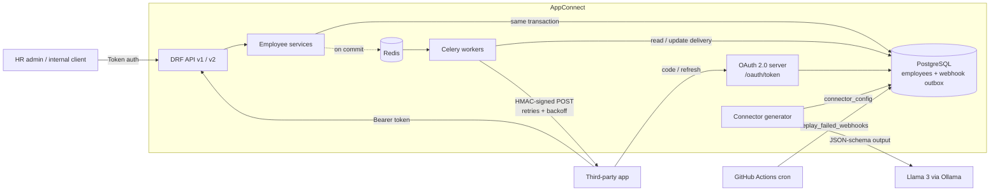

# AppConnect: Integration Platform & App Marketplace

[](https://github.com/ananthkrishh/appconnect/actions/workflows/ci.yml)

AppConnect is a Django REST Framework service over a PostgreSQL employee-records model. Third-party apps (payroll, benefits, IT provisioning) can be installed from a built-in marketplace. They connect over OAuth 2.0, read employees with scoped tokens, and receive HMAC-signed webhooks whenever someone is hired, updated or terminated. For each new app, a Llama 3 model (run locally through Ollama) reads the app's OpenAPI spec and drafts the field mapping, so adding an app usually means reviewing a JSON file rather than writing new code.

**Stack:** Python 3.12, Django 6, Django REST Framework, drf-spectacular (OpenAPI), PostgreSQL 16, Celery + Redis, httpx, jsonschema, Ollama (Llama 3), pytest, ruff, GitHub Actions, Docker Compose.



## What's in it

### 1. Versioned REST API (`/api/v1`, `/api/v2`)

| | v1 (deprecated) | v2 (current) |
|---|---|---|
| Employee id | integer pk | public UUID |
| Shape | flat, `title` | `job_title`, `employment_type`, `manager_id`, timestamps |
| Pagination | page number | cursor (stays stable when rows are inserted) |
| Lifecycle | `PATCH status` | read-only `status`; `POST /employees/{id}/terminate/` |
| Extras | `Deprecation` / `Sunset` headers | marketplace, installations, webhook delivery log |

Every endpoint subclasses one of the shared base viewsets in [`apps/core/viewsets.py`](apps/core/viewsets.py). That gives each endpoint the same behaviour without extra code:

- **One error format.** Every non-2xx response is `{"error": {"code", "message", "details", "request_id"}}`, including Django 404s, model validation errors and unhandled 500s ([`apps/core/exceptions.py`](apps/core/exceptions.py)).
- **Filtering, search and ordering** are declared on the viewset (`filter_fields = {"status": "status"}` also accepts `?status=a,b`).
- **Malformed ids return 404**, never 500.
- **Per-endpoint version pinning** ([`apps/core/versioning.py`](apps/core/versioning.py)), so the generated OpenAPI document for each version only lists the endpoints that version actually has.
- **Request ids.** Each request gets an `X-Request-ID`, which is echoed back in the response and included in error bodies.

Interactive docs are at `/api/v2/docs/` and `/api/v1/docs/`. Committed snapshots of the schemas are in [`openapi/`](openapi/).

### 2. App marketplace over OAuth 2.0

AppConnect acts as the OAuth authorization server ([`apps/marketplace/oauth.py`](apps/marketplace/oauth.py)):

1. **Discover:** `GET /api/v2/apps/` lists published apps and shows which ones are installed.
2. **Install:** `POST /api/v2/apps/{slug}/install/` is the admin consent step. It validates `redirect_uri` and scopes, supports PKCE (S256), and returns the app's redirect URL with a one-time code plus the installation's webhook signing secret.
3. **Token exchange:** the app calls `POST /oauth/token/` with `authorization_code` (or `refresh_token`) and gets a Bearer token limited to `employees:read` and/or `employees:write`.
4. **Uninstall:** `DELETE /api/v2/installations/{id}/` revokes all tokens, cancels pending webhooks and sends a final `app.uninstalled` event.

Security details:
- Client secrets, codes and tokens are stored only as SHA-256 hashes.
- Refresh tokens rotate, so each one works once.
- Reusing an authorization code revokes every token issued from it (RFC 6749 §4.1.2).
- The token endpoint is rate-limited, returns RFC-format errors and sends `Cache-Control: no-store`.
- App tokens can never reach the admin marketplace endpoints.

### 3. Webhooks: transactional outbox, Celery, retries, idempotency

- **Outbox.** `hire_employee`, `update_employee` and `terminate_employee` ([`apps/employees/services.py`](apps/employees/services.py)) write one `WebhookDelivery` row per subscribed installation in the same database transaction as the employee change. The Celery task is enqueued only `on_commit`. If the transaction rolls back, nothing is sent. If Redis is down, the rows wait for the replay job.
- **Signing.** Requests carry `X-AppConnect-Signature: t=<unix>,v1=<hex>`, an HMAC-SHA256 over `"{t}.{body}"` that covers the timestamp so old requests can't be replayed. Several `v1` values are accepted, which allows secret rotation ([`apps/webhooks/signing.py`](apps/webhooks/signing.py)).
- **Idempotency.** Each delivery has a fixed `Idempotency-Key` that is reused on every retry and replay. A unique `(installation, event_id)` constraint stops the same event from being queued twice.
- **Retries** ([`apps/webhooks/delivery.py`](apps/webhooks/delivery.py)):
  - 5xx responses, timeouts, connection errors, 408/409/425/429 → retried with exponential backoff and jitter. `Retry-After` is honoured.
  - Any other 4xx → failed straight away.
  - The attempt budget is stored on the database row, so it survives worker restarts.
- **Replay.** `python manage.py replay_failed_webhooks` re-queues failed deliveries and ones stuck in pending. A [scheduled GitHub Action](.github/workflows/replay-webhooks.yml) runs it every hour. A single delivery can also be replayed with `POST /api/v2/webhook-deliveries/{id}/replay/`.

[`examples/receiver.py`](examples/receiver.py) is a minimal receiver that verifies signatures and dedupes on the idempotency key.

### 4. AI-assisted connector generator (Llama 3 via Ollama)

```bash
python manage.py generate_connector examples/specs/acme_payroll.yaml --app acme-payroll --save
```

1. [`spec_parser.py`](apps/connectors/spec_parser.py) loads the third-party OpenAPI spec and finds the request body that creates a person. It resolves `$ref` and `allOf`, skips `readOnly` fields, and flattens nested objects into dotted paths such as `contact.workEmail`.
2. [`generator.py`](apps/connectors/generator.py) asks Llama 3 for a mapping. Ollama's structured-output mode constrains the model's reply to the connector JSON Schema.
3. [`config_schema.py`](apps/connectors/config_schema.py) validates the draft in two passes: first its shape against the JSON Schema, then its meaning against the spec (target fields exist, required targets are covered, types fit, enum targets use a `map` table). If validation fails, the errors go back to the model for one repair attempt.
4. If Ollama is unreachable or the draft still fails, a deterministic [synonym and similarity mapper](apps/connectors/heuristic.py) produces a starting point, and the command refuses `--save` until the config validates.

The result is a JSON config, never generated code. At delivery time it reshapes `employee.*` payloads for that app ([`transform.py`](apps/connectors/transform.py)):

```json
{"source": "employment_type", "target": "workerType", "transform": "map",
 "values": {"full_time": "EMPLOYEE_FT", "part_time": "EMPLOYEE_PT", "contractor": "CONTRACTOR"}}
```

### 5. CI and upkeep (GitHub Actions)

[`ci.yml`](.github/workflows/ci.yml):
- **lint:** `ruff check` and `ruff format --check`.
- **test:** runs against Postgres and Redis service containers. Checks that migrations are up to date, runs unit tests and then integration tests, and fails if combined coverage is below 85%. JUnit and coverage reports are uploaded as artifacts.
- **openapi:**
  - Regenerates the v1 and v2 schemas and fails if the committed snapshots are stale.
  - Diffs the base branch's `openapi/v2.yaml` against the PR's with [`scripts/openapi_diff.py`](scripts/openapi_diff.py). Removed paths or fields, new required inputs, type changes and narrowed enums are all breaking and block the merge.

[`replay-webhooks.yml`](.github/workflows/replay-webhooks.yml) is the hourly replay job. It reads `DATABASE_URL` and `REDIS_URL` from environment secrets and does nothing if they aren't set.

## Running it

```bash
make install          # venv + dependencies (Python 3.12+)
make up               # Postgres + Redis via docker compose
make migrate seed     # schema + demo admin, employees and the "acme-payroll" app
make run              # http://localhost:8000/api/v2/docs/
make worker           # in another terminal: Celery worker for webhooks
```

Or run everything in containers: `docker compose up --build`. Add `--profile llm` to start Ollama too, then run `docker compose exec ollama ollama pull llama3`.

Try the full flow with the seeded app (`seed_demo` prints the admin token and the app credentials):

```bash
# 1. admin installs the app -> response has redirect_url (?code=...) and webhook_secret
curl -X POST localhost:8000/api/v2/apps/acme-payroll/install/ \
  -H "Authorization: Token $ADMIN_TOKEN" -H "Content-Type: application/json" \
  -d '{"redirect_uri": "http://localhost:9000/oauth/callback"}'

# 2. start the sample receiver with that secret
WEBHOOK_SECRET=whsec_... python examples/receiver.py

# 3. the app exchanges the code
curl localhost:8000/oauth/token/ -d grant_type=authorization_code -d client_id=$CLIENT_ID \
  -d client_secret=$CLIENT_SECRET -d code=$CODE -d redirect_uri=http://localhost:9000/oauth/callback

# 4. hire someone: the receiver prints a verified employee.hired event
curl -X POST localhost:8000/api/v2/employees/ -H "Authorization: Token $ADMIN_TOKEN" \
  -H "Content-Type: application/json" \
  -d '{"first_name":"Grace","last_name":"Hopper","email":"grace@example.com","hire_date":"2024-02-01"}'
```

## Tests

```bash
make test           # everything + coverage
make unit           # fast unit tests
make integration    # end-to-end: OAuth install -> outbox -> Celery -> signed webhook -> uninstall
make lint
make openapi        # refresh openapi/*.yaml after an API change
```

The integration tests use the real Celery task (run eagerly), the real outbox and the real httpx client code. Only the third-party endpoint is faked, with a respx receiver that checks signatures and dedupes on the idempotency key. Those tests cover a delivery that fails twice before landing, and one that runs out of retries and is recovered by the replay job.

## Layout

```
apps/
  core/          base viewsets, error envelope, pagination, filters, version pinning, permissions
  employees/     Employee model, v1/v2 serializers + viewsets, lifecycle services
  marketplace/   App / Installation / OAuth models, authorization server, bearer auth
  webhooks/      outbox model, dispatcher, signing, delivery + backoff, Celery task, replay
  connectors/    OpenAPI spec parser, Ollama client, generator, validation, runtime transform
config/          settings, URLs, Celery app
scripts/         openapi_diff.py (breaking-change gate)
openapi/         committed v1 / v2 schemas
examples/        sample third-party spec and webhook receiver
tests/           unit/ and integration/
```
